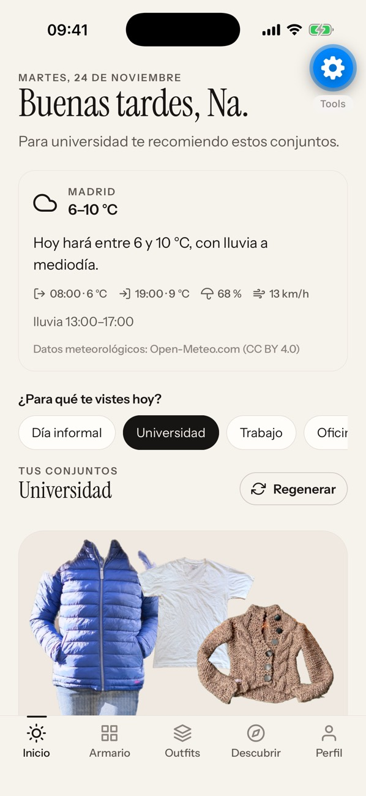
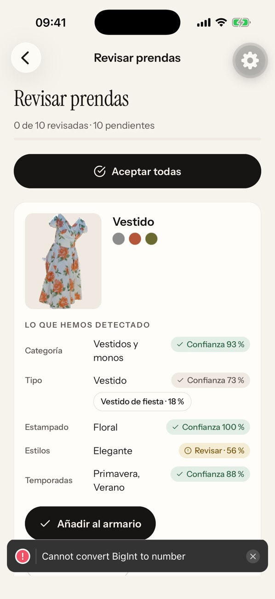
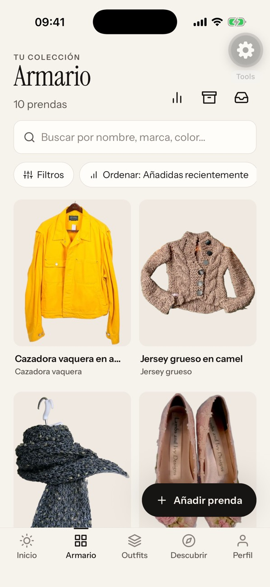
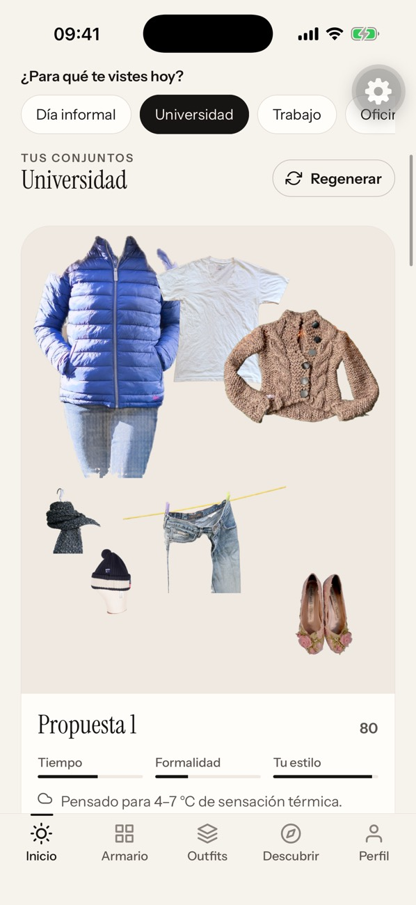
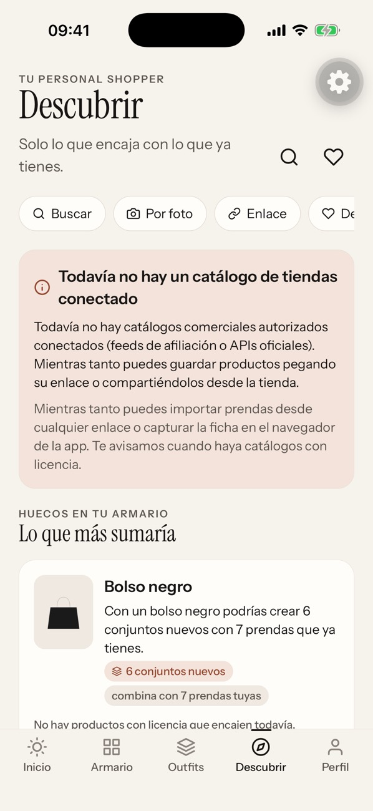
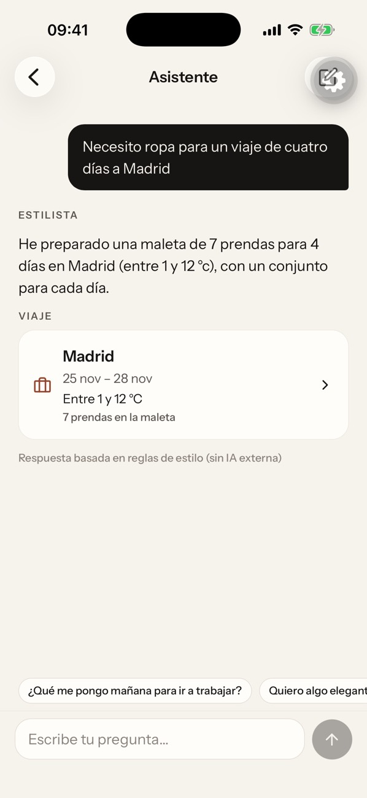
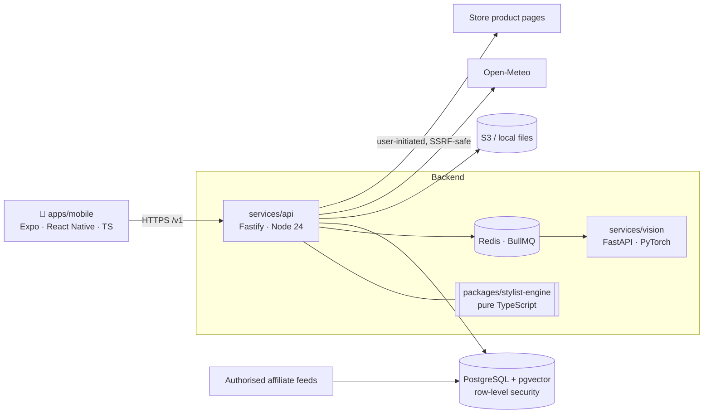

<div align="center">



# DressIt

**Your real wardrobe, a stylist that dresses you for the whole day's weather, and a personal shopper that only suggests what adds to what you already own.**

[](https://github.com/Ale-Newport/DressIt/actions/workflows/ci.yml)
[](https://github.com/Ale-Newport/DressIt/actions/workflows/codeql.yml)
[](https://github.com/Ale-Newport/DressIt/releases/latest)
[](LICENSE)
<br>


[What it is](#what-it-is) ·
[The honest part](#the-honest-part) ·
[Getting started](#getting-started) ·
[How it is built](#how-it-is-built) ·
[Docs](#documentation) ·
[Contributing](CONTRIBUTING.md)

</div>

---

## What it is

You photograph your clothes once — ten at a time from the gallery if you like.
DressIt cuts each garment out of the background, recognises what it is and asks
you only about what it is unsure of. From then on, every morning it reads the
forecast for **your whole day**, not just this hour, looks at your plans, and
proposes complete outfits made only from clothes you actually own and that are
not in the laundry.

When you want something new, it does the reverse of a shop: it tells you which
piece would unlock the most new outfits with what you already have, shows you
those outfits before you buy, and sends you to the real product page.

The app, its copy and its recommendations are in **Spanish**; the first market is Spain.

| | |
|---|---|
| 📸 **Digitise** | Camera, gallery or batches; several garments per photo; background removed; duplicates caught; confidence on every attribute |
| 🧥 **Wardrobe** | Search and filters, laundry / lent / stored states, spaces, tags, bulk edit, cost per wear, statistics |
| ☔️ **Dress for the day** | Complete outfits for the weather from when you leave home until you get back and for your plans, with the reasons, a removable layer when it warms up, rain protection when it rains |
| 🔁 **Learns from you** | Accept, reject, rate, swap one piece, "I wore it": a ranking model updated by your feedback, visible in your profile |
| 🗓️ **Plan** | Week and month planner with conflict detection, "suggest my week", trip capsules with a packing list |
| 🛍️ **Shop with judgement** | Wardrobe gaps ("with a black bag you could make 6 new outfits"), try a product against your wardrobe before buying, never pushes near-duplicates |
| 💬 **Ask** | "¿Qué me pongo mañana para ir a trabajar?", "viaje de cuatro días a Madrid" — answered by calling the same functions as the app, with no paid AI required |
| 🏷️ **Catalogue photos** | A wrinkled T-shirt on the bed becomes a professional product photo: first the store's official photo of that very garment (reverse image search with Google Lens, Cloud Vision, Lykdat and the authorised catalogues, verified so a lookalike is never taken for it), otherwise an AI packshot with the garment laid out — sleeves and legs extended, front view, white background — checked for fidelity and arrangement, retried with corrections, and chosen by you next to your own photo |
| ✨ **Avatar** | Optional generative AI (open, commercially licensed models on our own server): you wearing the day's outfit, always labelled as AI-generated and shown next to the real thing |
| 🧠 **Apple Intelligence** | On compatible iPhones, Apple's on-device model helps the assistant understand you, summarises your wardrobe and describes a garment from its photo — all on the phone, and never deciding anything on its own |
| 🔒 **Private** | Location rounded to ~1 km, photos stripped of EXIF/GPS and processed on our own servers, GDPR export and deletion |

<p align="center">
  
  
  
  
  
</p>

---

## The honest part

**No Spanish retailer offers a self-serve product API.** Inditex's developer
portal is currently unpublished; the realistic routes are affiliate networks,
and they approve publishers one by one. So DressIt is built to work without a
catalogue, and to light up when one is connected:

| Route | Status today |
|---|---|
| Paste a product link, read on the server | ✅ Springfield, Cortefiel, Pedro del Hierro, Nike — measured on 2026-11-24 |
| Paste a link for the other 15 stores (Zara and Inditex, El Corte Inglés, Mango, H&M, Zalando, Decathlon, adidas…) | ⛔ they block automated reads (403/429); DressIt does **not** work around that |
| Open the page in the in-app browser or share it from Safari | ✅ the app reads the product data from the page *you* are viewing |
| Licensed catalogues for search, Discover and visual search | ⏳ connectors ready for Awin, Rakuten, Tradedoubler and CJ; waiting for each store to approve DressIt (step-by-step: [`docs/conectar-tiendas.md`](docs/conectar-tiendas.md)) |

Every store field carries where it came from and when it was verified; prices
older than 24 h are shown as unverified; inferred values (type, colour) are
labelled as inferred. Store photos are not shown unless the source licenses them.

Other things it says rather than hides:

- **Vision is good, not perfect.** 95.9 % category accuracy on 58 openly licensed
  photos, but the main colour is right only ~70 % of the time, and cut-outs of
  worn or hanging clothes can keep a bit of leg, a hanger or a washing line. When
  the model is unsure it asks instead of guessing.
- **The free Open-Meteo tier is non-commercial.** A paid plan is needed to launch.
- **Verified in the iOS Simulator, not yet on a physical iPhone or on Android.**

Full list: [`docs/limitaciones.md`](docs/limitaciones.md). Store research and the
measured matrix: [`docs/comercios.md`](docs/comercios.md).

---

## Getting started

Requirements: macOS, Node ≥ 24, pnpm 10, PostgreSQL ≥ 15 with
[pgvector](https://github.com/pgvector/pgvector), Redis, Python ≥ 3.11 with
[uv](https://docs.astral.sh/uv/), and Xcode for iOS.

```bash
git clone https://github.com/Ale-Newport/DressIt.git && cd DressIt
pnpm install
pnpm db:setup      # creates .env with random secrets, the databases, the app role, and migrates
```

Then, in three terminals:

```bash
pnpm dev:api                                                        # http://localhost:3000 · OpenAPI at /docs
cd services/vision && uv sync && uv run uvicorn app.main:app --port 8001   # first run downloads ~3 GB of models
pnpm --filter @dressit/mobile ios                                   # builds and opens the app in the iOS Simulator
```

Optional generative features (each its own server, models downloaded by its setup script):
`services/imagegen/setup.sh && services/imagegen/run.sh` (catalogue packshots, avatar views; ComfyUI on
:8188, `IMAGEGEN_COMFY_URL`) and `services/tryon/setup.sh && services/tryon/run.sh` (virtual try-on
on :8002, `TRYON_SERVICE_URL`). See [`docs/probador-virtual.md`](docs/probador-virtual.md). Reverse
image search and hosted generators (FASHN, fal.ai) only need their keys in `.env`; see
[`docs/foto-catalogo.md`](docs/foto-catalogo.md#8-configuración).

Optional: `pnpm db:seed:demo` creates an account with 28 garments marked DEMO
(credentials are written to `.demo-credentials.local`).

On a physical iPhone: `cd apps/mobile && npx expo run:ios --device` with your own
Apple team — see [`docs/mobile.md`](docs/mobile.md). With Docker:
`docker compose up -d postgres redis minio`. Step-by-step guide:
[`docs/instalacion-macos.md`](docs/instalacion-macos.md).

---

## How it is built



| Part | What it does |
|---|---|
| `apps/mobile` | Expo SDK 58 app: Expo Router, React Query with an offline cache, native photo picker and camera, share extension, in-app browser capture, Spanish i18n, accessibility labels throughout |
| `services/api` | Fastify API and worker. 46-table schema with **row-level security forced on every personal table**, argon2id + rotating refresh tokens, async photo pipeline, SSRF-safe link import with provenance, feed ingestion, GDPR export/deletion and retention jobs, Prometheus metrics |
| `packages/stylist-engine` | Deterministic recommendation engine: CIELAB/CIEDE2000 colour harmony on the painter's wheel, an ISO 9920 clothing-insulation model across the day, a logistic ranking model updated online by feedback, MMR diversity, explanations derived from score contributions, marginal utility of purchases |
| `services/vision` | Marqo-FashionSigLIP (embeddings, zero-shot attributes with calibrated abstention), Grounding DINO + SAM 2.1 (several garments per photo), rembg (background removal), EasyOCR (receipts and labels) |
| `services/tryon` | Virtual try-on: FASHN VTON v1.5 dresses the user's saved avatar one garment at a time (inner to outer layers, cached per step), Sapiens2 body parsing for the clothing mask and the fidelity check |
| `services/imagegen` | ComfyUI server with Qwen-Image-Edit-2511 workflows: catalogue packshots of garments (re-arranged flat lay / ghost mannequin), shoes/accessories pass and extra avatar views |
| `packages/shared` | Domain vocabulary (garments, colours, materials, occasions with clo and formality values) and the typed API contract shared by app and server |

Why each choice was made: [`docs/adr/`](docs/adr/README.md). Engine internals:
[`docs/recomendaciones.md`](docs/recomendaciones.md). Vision pipeline, licences
and evaluation: [`docs/vision.md`](docs/vision.md).

---

## Privacy and security

- Personal data is isolated **in the database**, not only in application code: the
  API connects as a non-owner role and every request runs inside a transaction
  that sets the user; a test proves another user's rows are invisible over HTTP
  and over raw SQL.
- Photos are re-encoded on upload (EXIF and GPS removed), stored per user and
  served only through short-lived signed URLs. They are analysed on our own
  servers and never sent to a third party or used to train external models.
- Location is rounded to ~1 km on the device; only title, time and place of
  calendar events are read, and only with consent.
- Product-link import cannot be pointed at internal networks: every resolved
  address is checked at connect time and every redirect is re-validated.
- Consents are versioned and revocable; data export and permanent deletion are
  one tap away.

Report vulnerabilities privately: [`SECURITY.md`](SECURITY.md). Details:
[`docs/privacidad-seguridad.md`](docs/privacidad-seguridad.md).

---

## Tests and evidence

```bash
pnpm typecheck && pnpm test
cd services/vision && VISION_BACKEND=stub uv run pytest -q
```

| Suite | Tests | Covers |
|---|---|---|
| `apps/mobile` | 81 | API client (token refresh, errors), components, accessibility, screens against recorded API responses, regressions found in the simulator, catalogue photo card (compare, choose, accept warnings, regenerate, ask for another photo) |
| `services/api` | 152 | Catalogue photo pipeline (reverse-search and generator adapters against their documented contracts, exact vs possible matches, retries with corrections, cache, limits, choice applied to the wardrobe), Catalogue connectors against synthetic feeds and mocked APIs, the on-device assistant reading grounded in the text, and integration tests against a real PostgreSQL with RLS: only available garments in outfits, weather changes recommendations, feedback changes the ranking, no near-duplicate purchases, stale prices flagged, users never mixed, providers going down |
| `packages/stylist-engine` | 24 | Determinism, complete outfits, whole-day weather, formality, learning, purchase utility, 1,500-garment wardrobe |
| `packages/shared` | 20 | CIEDE2000 against published reference values, colour families, vocabulary integrity |
| `services/vision` | 88 | Colour extraction, perceptual hashing, HTTP contract, abstention thresholds, catalogue photo check (background removal alone is not a packshot, symmetry, tilt, pose-invariant colour/texture/text fidelity) |

Evidence from real services, with dates and raw numbers, in
[`docs/evidence/`](docs/evidence/): store link import against 19 Spanish store
pages, the vision evaluation, a 10-photo end-to-end digitisation (10/10 categories
and types, 0.9 s per photo), engine and API latency (recommendations p95 19 ms),
and a full walkthrough of the app in the iOS Simulator.

---

## Documentation

The technical documentation is in Spanish.

| Topic | Document |
|---|---|
| Architecture | [`docs/arquitectura.md`](docs/arquitectura.md) |
| Decisions | [`docs/adr/`](docs/adr/README.md) |
| Data model | [`docs/modelo-datos.md`](docs/modelo-datos.md) |
| HTTP API | [`docs/api.md`](docs/api.md) · live OpenAPI at `/docs` |
| Recommendation engine | [`docs/recomendaciones.md`](docs/recomendaciones.md) |
| Vision | [`docs/vision.md`](docs/vision.md) |
| Catalogue photos (official photo search, AI packshot) | [`docs/foto-catalogo.md`](docs/foto-catalogo.md) · [evidence](docs/evidence/foto-catalogo-2026-11-24.md) |
| Avatar · virtual try-on | [`docs/generacion-imagenes.md`](docs/generacion-imagenes.md) · [`docs/probador-virtual.md`](docs/probador-virtual.md) |
| Stores and catalogues | [`docs/comercios.md`](docs/comercios.md) |
| Privacy and security | [`docs/privacidad-seguridad.md`](docs/privacidad-seguridad.md) |
| Mobile app | [`docs/mobile.md`](docs/mobile.md) |
| Deployment and app stores | [`docs/despliegue.md`](docs/despliegue.md) |
| Research (stack, competitors, stores) | [`docs/research/`](docs/research/) |
| Roadmap · limitations | [`docs/roadmap.md`](docs/roadmap.md) · [`docs/limitaciones.md`](docs/limitaciones.md) |

---

## Roadmap

- Connect the first licensed catalogues (Awin, Rakuten) to light up Discover and visual search.
- Verify on a physical iPhone and on Android; publish development builds.
- On-device background removal for instant previews.
- Optional LLM for the assistant, behind explicit consent.
- Offline evaluation of the ranking model on real feedback.

## License

[MIT](LICENSE) © 2026 Alejandro Newport Diaz.

Weather data by [Open-Meteo.com](https://open-meteo.com) (CC BY 4.0). Model
weights are downloaded at runtime under their own licences, listed in
[`docs/vision.md`](docs/vision.md), [`docs/generacion-imagenes.md`](docs/generacion-imagenes.md) and
[`docs/probador-virtual.md`](docs/probador-virtual.md); evaluation photos are fetched from their
sources with the credits in `services/vision/eval/manifest.csv`.
