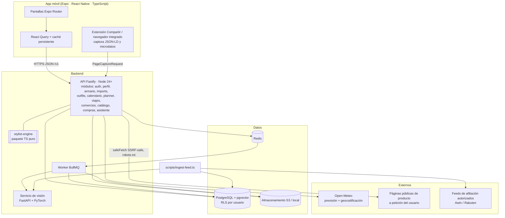

# Arquitectura

## Componentes



| Componente | Tecnología | Motivo (ver ADRs) |
|---|---|---|
| App | Expo SDK 58, React Native 0.88, Expo Router, React Query | Un código para iOS/Android, builds de desarrollo, módulos nativos (cámara, calendario, compartir). [ADR-0001](adr/0001-stack-movil.md) |
| API | Node 24+ con *type stripping* (TS sin compilar), Fastify 5, zod, Kysely | Rendimiento, tipado extremo a extremo, contrato compartido con el móvil. [ADR-0002](adr/0002-backend.md) |
| Datos | PostgreSQL 17 + pgvector, RLS | Relacional + vectores en una sola base, aislamiento por usuario en la propia base. [ADR-0003](adr/0003-datos-y-rls.md) |
| Jobs | BullMQ (Redis) / cola en proceso en desarrollo | Procesamiento asíncrono de fotos con reintentos. |
| Visión | Python, FastAPI, PyTorch, Marqo-FashionSigLIP, Grounding DINO, rembg | Modelos abiertos con licencia comercial, ejecución local sin APIs de pago. [ADR-0004](adr/0004-vision.md) |
| Recomendaciones | `@dressit/stylist-engine` | Reglas + restricciones + ranking aprendido + MMR, sin LLM obligatorio. [ADR-0005](adr/0005-motor-recomendaciones.md) |
| Meteorología | Open-Meteo (CC BY 4.0) | Previsión horaria gratuita en desarrollo; plan comercial para el lanzamiento. [ADR-0006](adr/0006-meteorologia.md) |
| Comercios | Lectura de datos estructurados a petición, captura en dispositivo, feeds de afiliación | Únicas vías legítimas disponibles hoy. [ADR-0007](adr/0007-comercios.md) |
| Asistente | Intérprete de intenciones en español + herramientas reales | Funciona sin APIs de pago; LLM opcional con consentimiento. [ADR-0008](adr/0008-asistente.md) |

## Fronteras de módulos (API)

```
services/api/src/
  app.ts, routes.ts       HTTP: plugins, auth, validación zod, errores en español
  context.ts              dependencias inyectadas (db, storage, visión, tiempo, cola, catálogo)
  db/                     Kysely + withUser() (transacción con app.user_id → RLS) + migrador
  lib/                    safe-fetch (SSRF), tokens, storage, URLs firmadas, métricas, auditoría
  modules/
    auth/ profile/        cuentas, sesiones, preferencias, consentimientos, exportación/borrado RGPD
    wardrobe/ images/     inventario personal, atributos con procedencia, disponibilidad, estadísticas
    imports/              fotos (pipeline de visión, duplicados, revisión), tickets/correos/etiquetas
    vision/ weather/      clientes de servicios externos
    outfits/ planner/ trips/ calendar/   puente con el motor, feedback, historial, calendario, viajes
    retail/ catalog/ shopping/           tiendas, importación por enlace, catálogo autorizado, compras
    assistant/            estilista conversacional
```

Reglas: los módulos de dominio no importan Fastify; todo acceso a datos personales pasa por
`withUser`; el catálogo comercial global vive en tablas separadas del inventario personal.

## Flujos principales

**Digitalizar con la cámara (lote):** subir fotos (`/v1/uploads`: valida formato real, corrige
orientación, **elimina EXIF/GPS**, miniatura, hash perceptual) → `/v1/imports/photos` crea un trabajo →
el worker llama al servicio de visión (detección, recorte sin fondo, atributos con confianza, embedding)
→ detecciones con duplicados marcados (foto idéntica, casi idéntica por dHash, prenda similar por
embedding) → revisión en la app (aceptar todo / corregir) → prendas con atributos y procedencia.

**¿Qué me pongo hoy?:** `/v1/outfits/recommendations` → contexto (previsión horaria de la ventana del
usuario, evento del calendario, ocasión, ajustes) → motor → conjuntos persistidos con características y
semilla → impresiones en `recommendation_events` → feedback/cambios actualizan el modelo personal.

**Producto de tienda:** enlace → `safeFetch` (SSRF, robots.txt) → extracción schema.org → producto
importado privado con procedencia; si la tienda bloquea, captura en el dispositivo → simulación con el
armario → enlace auténtico de compra → «Ya lo tengo» lo convierte en prenda.

## Observabilidad

- `GET /metrics` (Prometheus): latencia HTTP por ruta, latencia y errores de dependencias externas
  (visión, Open-Meteo), tiempo del motor por operación, eventos de negocio y **unidades de coste**
  (`dressit_cost_units_total`, para llamadas de pago/cuota).
- `GET /ready`: base de datos, servicio de visión, cola y almacenamiento.
- Logs estructurados (pino) con redacción de cabeceras de autorización y contraseñas.

## Escalabilidad

- API sin estado (JWT de 15 min + refresh rotatorio), escalable horizontalmente.
- Trabajos pesados (visión, ingesta) en workers separados; la visión escala aparte (CPU/GPU).
- Índices por usuario en todas las tablas personales; HNSW en embeddings; caché de previsión por celda
  de ~11 km y día (compartida entre usuarios, sin datos personales).
- Miles de prendas por usuario: el motor poda a top-N por capa (test con 1 500 prendas).
