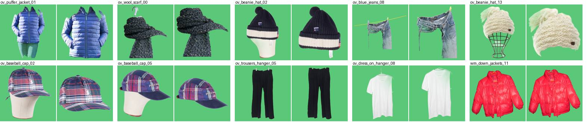
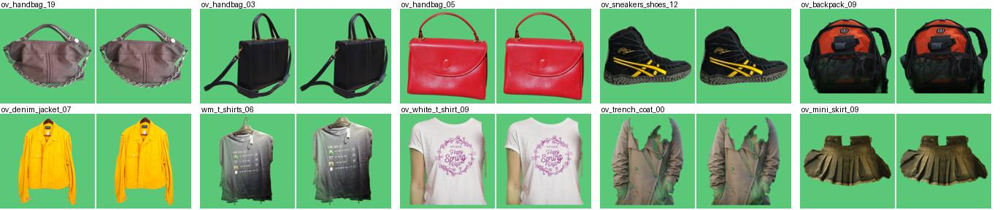
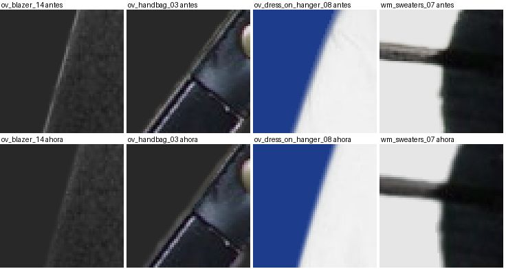

# Evidencia: limpieza del recorte de prendas, 2026-11-24

Mejora del recorte de `services/vision` para que contenga solo la prenda: sin soportes de
exposición, sin otras prendas debajo y sin halo del fondo en los bordes. Diseño y parámetros en
[`docs/vision.md` §2](../vision.md#2-pipeline-de-v1analyze) ("Limpieza del recorte en `single`",
"capas" y "Bordes sin halo").

## Problema observado

En el recorrido del simulador de iOS, los recortes de prenda suelta conservaban cosas que no son
la prenda:

| Foto | Qué sobraba | Causa |
|---|---|---|
| Plumífero puesto | Los vaqueros y las piernas bajo la chaqueta | Escena `worn` → detector + SAM; SAM se extendió a los vaqueros y las capas solo se aplicaban en modo multi. |
| Gorro en una cabeza de maniquí | La cabeza | rembg segmenta todo lo saliente. |
| Bufanda en un busto con percha | El gancho de la percha | Ídem. |
| Vaqueros en un tendedero | La cuerda y las pinzas | Ídem. |
| Varias | Línea clara o de color en el borde | Los píxeles semitransparentes conservan el color del fondo. |

## Qué se ha cambiado

1. **Soportes fuera (single, ruta rembg, escena no `worn`).** Grounding DINO (consultas de prenda +
   lista cerrada de soportes, nunca personas) y SAM 2.1 proponen regiones en paralelo con rembg;
   FashionSigLIP verifica cada región frente a prendas, partes de prenda y soportes, y se restan
   las que son soporte con P ≥ 0,5. Caso especial para cabezas de maniquí bajo gorros/gorras
   (P ≥ 0,25, en la parte baja del objeto, cuando la foto entera parece una prenda de cabeza).
2. **Líneas finas que cruzan el borde de la foto** (tendedero, barra) fuera; las partes finas de
   la prenda que acaban dentro de la foto (asas, cadenas, cordones) se conservan.
3. **Capas también en single**, solo con prendas de ropa: la chaqueta pierde los píxeles de los
   vaqueros reconocidos.
4. **Bordes sin halo**: color de primer plano estimado (`pymatting.estimate_foreground_ml`, MIT)
   en los píxeles semitransparentes de los recortes devueltos.

Se probó y **se descartó**:

- Un único prompt con prendas y soportes para todo: Grounding DINO tiny mezcla las etiquetas (el
  gorro pasa a "mannequin head") y empeora las cajas de prendas. Por eso el modo multi y la
  ruta `worn` siguen con su prompt de prendas.
- Recortar la máscara de rembg con la caja de la prenda principal: las cajas de Grounding DINO
  tiny en estas fotos están fragmentadas o mal etiquetadas (la cabeza del maniquí sale como
  "shoe"), y cortarían la prenda.
- Fiarse de la etiqueta del detector para decidir qué es soporte: "mannequin" aparece sobre casi
  cualquier prenda y "clothes hanger" sobre bolsos.
- Umbral 0,4 o regla "clase más probable = soporte": sobre 167 regiones etiquetadas a mano
  (24 soportes) quitaban herrajes y cierres de bolsos, el logo de una gorra o los cordones de
  una zapatilla (4–9 falsos positivos). Con 0,5 hubo 0 falsos positivos y 17/24 soportes.
- Quitar en multi los ítems que parecen soporte: no cambió ningún resultado del conjunto de
  evaluación, así que no se incorporó.
- Descontaminar los bordes de todos los candidatos antes de clasificar: +120 ms en multi sin
  efecto en la clasificación (que ve el recorte sobre blanco); ahora solo se hace en los
  recortes devueltos y a ≤ 512 px.

## Entorno y comandos

Apple M2 Max, 64 GB, macOS 27.2.1, Python 3.13.9, PyTorch 2.15.0 (MPS), onnxruntime 1.32.0 con
CoreML EP, mismos modelos y revisiones que en [`vision-2026-11-24.md`](vision-2026-11-24.md).
"Antes" es el código de `main` (`dfab4c5`) ejecutado el mismo día en la misma máquina.

```
VISION_BACKEND=stub uv run pytest -q          # 63 passed (50 previos + 13 nuevos en tests/test_masks.py)
uv run python scripts/evaluate.py --tag before   # en main, antes del cambio
uv run python scripts/evaluate.py                # con el cambio → eval/out/results.json
```

## Métricas sobre las 58 fotos de evaluación

| Métrica | Antes (todas / test) | Después (todas / test) |
|---|---|---|
| Categoría: acierto (cobertura) | 95,9 % (100 %) / 92,9 % (100 %) | **95,9 % (100 %) / 92,9 % (100 %)** |
| Subcategoría: acierto cuando responde (cobertura) | 93,3 % (91,8 %) / 92,6 % (96,4 %) | 93,3 % (91,8 %) / 92,6 % (96,4 %) |
| Estampado: acierto cuando responde (cobertura) | 88,9 % (87,8 %) / 85,0 % (90,9 %) | 88,6 % (85,4 %) / 85,0 % (90,9 %) |
| Color principal en familia aceptada (todas / test) | 72,3 % / 81,5 % | 74,5 % / 77,8 % |
| Color en el top-3 (todas / test) | 83,0 % / 81,5 % | 83,0 % / 81,5 % |
| Multi: recall / precisión por categoría | 82,1 % / 63,9 % | 82,1 % / 63,9 % |
| Texto español → prenda, 70 clases top-1 (traducido) | 91,8 % | 91,8 % |
| Texto español → prenda, consultas R@1 (traducido) | 94,9 % | 92,3 % |
| Latencia single p50 / p95 | 634 / 1042 ms | 786 / 1090 ms |
| Latencia multi p50 / p95 | 1073 / 1601 ms | 1132 / 1653 ms |

Cambios foto a foto en single (el resto de predicciones son idénticas):

| Foto | Cambio | ¿Mejor? |
|---|---|---|
| `ov_baseball_cap_05` | color principal blanco (la cabeza de maniquí) → morado | sí |
| `wm_down_jackets_01` | color antracita → verde oliva | sí |
| `ov_baseball_cap_02` | color crudo (la cabeza) → azul marino | sin etiqueta de color |
| `ov_trousers_hanger_05` | subcategoría pantalón → pantalón de vestir | igual (ambas aceptadas) |
| `wm_t_shirts_06` | color gris → negro (proporciones 0,47/0,27 → 0,41/0,39) | no (borde de decisión) |
| `ov_blue_jeans_08` | estampado liso → abstención | no (deja de responder) |

Etapas (mediana, single): rembg ∥ propuestas 330 ms (rembg solo: 301 ms), soportes 80 ms,
recorte 73 ms, bordes 35 ms. El detector y SAM corren en otro hilo mientras rembg usa CoreML;
medido aparte, rembg solo tarda 242 ms y rembg ∥ detector 296 ms. El coste añadido en single es
de ≈ +150 ms en p50 y ≈ +50 ms en p95; en multi, ≈ +35–60 ms (bordes).

**Halo en el borde** (85 recortes devueltos del conjunto de evaluación): diferencia de L*
entre cada píxel semitransparente (25 < alfa < 230) y el píxel opaco más cercano. Mediana
18,8 → **10,9**, media 20,2 → 12,2, p90 33,1 → 21,8.

**Área de la máscara** (single, cambios > 0,3 %): `ov_baseball_cap_02` −37 %,
`ov_baseball_cap_05` −35 %, `ov_beanie_hat_02` −30 % (cabezas de maniquí); `ov_puffer_jacket_01`
−21 % (vaqueros); `ov_beanie_hat_13` −20 % (soporte de alambre); `ov_blue_jeans_08` −5 %
(tendedero y pinza); `ov_wool_scarf_00` −3 % (gancho); `ov_dress_on_hanger_08`,
`ov_trousers_hanger_05` y `wm_t_shirts_06` < 1 % (ganchos y pinzas). Las otras 39 fotos de una prenda no
cambian de área.

## Hojas antes / después

Solo fotos del conjunto de evaluación con licencia abierta (atribuciones abajo). En cada pareja,
a la izquierda el recorte de antes y a la derecha el de ahora, sobre fondo verde para que se vea
lo que sobra.

**Soportes y capas:**



**Controles (no deben cambiar: cadenas, asas, cordones) y casos pendientes:**



**Bordes** (ampliación ×3; fondo oscuro o de color para ver el halo):



## Fotos del recorrido del simulador

Las 12 fotos distintas guardadas por la API (`services/api/storage/u/*/*/original.jpg`, 31
ficheros, deduplicadas por pHash) se procesaron en single y multi. **No se publican** en este
repositorio; solo cifras y observaciones.

| Foto | Antes | Después |
|---|---|---|
| Plumífero puesto | Chaqueta + vaqueros y piernas (área 0,338) | Solo la chaqueta (0,266); quedan unos mechones de pelo en los hombros |
| Gorro en cabeza de maniquí | Gorro + cabeza (0,393) | Solo el gorro y su etiqueta colgante (0,277) |
| Bufanda en busto con percha | Con el gancho (0,343) | Sin gancho (0,334) |
| Vaqueros en el tendedero | Con cuerda y pinzas; color principal gris | Sin cuerda ni pinza morada (0,227 → 0,215); queda la pinza verde; color celeste (correcto) |
| Bolso con cadena | Cadena completa | Igual (no se toca) |
| Cazadora amarilla en percha | Con la percha de madera en el cuello | Igual: P(soporte) = 0,25, no se quita |
| Vestido puesto (multi) | Con brazos | Igual (no se detectan personas) |
| Gorra, zapatillas, bailarinas, cárdigan, camiseta | Limpios | Igual |

Categoría y subcategoría no cambian en ninguna de las 12. Latencia single (mediana de las 12):
755 → 803 ms.

## Límites que quedan

- Soportes que FashionSigLIP no reconoce con seguridad (P < 0,5) se quedan: la percha dentro
  del cuello de la cazadora, a veces la percha dentro de un plumífero, una pinza verde, el gancho
  negro de un expositor de camisetas. Bajar el umbral quitaba herrajes de bolsos.
- La verificación de regiones pequeñas es inestable: la misma percha puede dar 0,64 o 0,25 según
  la caja que la proponga.
- En multi no se quitan soportes: una cabeza de maniquí puede salir como "complemento".
- Ropa puesta: piel, pelo y brazos siguen entrando (política de no detectar personas).
- Una correa o asa fina que salga por el borde de la foto se quitaría como si fuera un
  tendedero.
- Umbrales y prompts de soportes se ajustaron con regiones de estas mismas 58 fotos
  (167 regiones etiquetadas a mano): hay riesgo de sobreajuste hasta evaluarlo con fotos reales.

## Atribuciones de las fotos de las hojas

| Id | Autor | Licencia | Origen |
|---|---|---|---|
| `ov_puffer_jacket_01` | Rydale Country Clothing | CC BY 2.0 | https://www.flickr.com/photos/182435424@N02/51530784288 |
| `ov_wool_scarf_00` | smittenkittenorig | CC BY 2.0 | https://www.flickr.com/photos/83202873@N00/3979862983 |
| `ov_beanie_hat_02` | Menswear Market | CC BY 2.0 | https://www.flickr.com/photos/85546319@N04/15754621447 |
| `ov_blue_jeans_08` | lifecreations | CC BY 2.0 | https://www.flickr.com/photos/70571033@N00/198419430 |
| `ov_beanie_hat_13` | Hygge Knits Canada | CC BY 2.0 | https://www.flickr.com/photos/167529369@N03/49041708832 |
| `ov_baseball_cap_02` | Menswear Market | CC BY 2.0 | https://www.flickr.com/photos/85546319@N04/15600797831 |
| `ov_baseball_cap_05` | Menswear Market | CC BY 2.0 | https://www.flickr.com/photos/85546319@N04/15938417431 |
| `ov_trousers_hanger_05` | sustainablejill | CC BY-SA 2.0 | https://www.flickr.com/photos/127081607@N04/40209768352 |
| `ov_dress_on_hanger_08` | geishaboy500 | CC BY 2.0 | https://www.flickr.com/photos/49503154413@N01/3214240974 |
| `wm_down_jackets_11` | sand | Dominio público | https://commons.wikimedia.org/wiki/File:Anorak01.jpg |
| `ov_handbag_19` | smittenkittenorig | CC BY 2.0 | https://www.flickr.com/photos/83202873@N00/7676818244 |
| `ov_handbag_03` | Denna Jones | CC BY 2.0 | https://www.flickr.com/photos/95267793@N00/2381701367 |
| `ov_handbag_05` | Denna Jones | CC BY 2.0 | https://www.flickr.com/photos/95267793@N00/3371006146 |
| `ov_sneakers_shoes_12` | wrestlinggear | CC BY 2.0 | https://www.flickr.com/photos/45514731@N03/4382156129 |
| `ov_backpack_09` | slgckgc | CC BY 2.0 | https://www.flickr.com/photos/14771153@N04/3770457870 |
| `ov_denim_jacket_07` | Menswear Market | CC BY 2.0 | https://www.flickr.com/photos/85546319@N04/14388620941 |
| `wm_t_shirts_06` | Silar | CC BY-SA 4.0 | https://commons.wikimedia.org/wiki/File:20181201_132511_Xmas_check_list,_Poland.jpg |
| `ov_white_t_shirt_09` | skeyndor.oficial | CC0 1.0 | https://www.flickr.com/photos/57794015@N05/51974969566 |
| `ov_trench_coat_00` | allistair | CC BY 2.0 | https://www.flickr.com/photos/94215313@N00/5930875899 |
| `ov_mini_skirt_09` | daily sunny | CC BY 2.0 | https://www.flickr.com/photos/53558245@N02/4978406579 |
| `ov_blazer_14` | striatic | CC BY 2.0 | https://www.flickr.com/photos/34427466731@N01/139219706 |
| `wm_sweaters_07` | milele | CC BY 2.0 | https://commons.wikimedia.org/wiki/File:Alice_starmore_design.jpg |

Las hojas son obras derivadas (recortes reducidos); las de CC BY-SA mantienen esa licencia.
