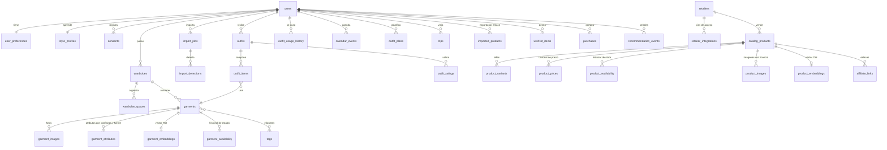

# Modelo de datos

Migraciones SQL en [`services/api/migrations/`](../services/api/migrations/) (aplicadas por
`pnpm db:migrate`, con checksum y bloqueo). Tipos TypeScript generados con `pnpm db:codegen`
(`services/api/src/db/types.ts`).

## Dominios

## Separación de datos

| Ámbito | Tablas | Acceso |
|---|---|---|
| **Inventario personal** | `garments`, `garment_*`, `tags`, `wardrobe_spaces`, `outfits`, `outfit_*`, `calendar_events`, `outfit_plans`, `trips`, `trip_items` | RLS por `user_id` |
| **Productos del usuario** (guardados o importados) | `imported_products`, `wishlists`, `wishlist_items`, `purchases` | RLS por `user_id` |
| **Comportamiento y aprendizaje** | `style_profiles`, `recommendation_events`, `outfit_ratings`, `assistant_messages` | RLS por `user_id` |
| **Catálogo comercial** (fuentes autorizadas) | `retailers`, `retailer_integrations`, `catalog_products`, `product_*`, `affiliate_links`, `catalog_sync_runs` | Global, sin datos personales |
| **Infraestructura** | `auth_identities`, `auth_sessions` (hash de refresh tokens), `weather_snapshots` (celda de ~11 km), `audit_events` (append-only) | Solo módulos internos |

## Decisiones de modelado

- **Valor vigente + procedencia**: `garments` guarda el valor actual de cada atributo (consultas
  rápidas, índices) y `garment_attributes` el historial con `confidence` (0–1) y `source`
  (`vision`, `user`, `retailer:<id>`); corregir un atributo inserta una fila con confianza 1 y marca
  las anteriores como no vigentes.
- **Disponibilidad**: estado actual en `garments.status` + historial en `garment_availability`
  (incluye «prestada a…»).
- **Dinero** en céntimos (`int`) + divisa ISO; **fechas locales** (`date`) como `YYYY-MM-DD`.
- **Ubicación** solo aproximada: 2 decimales (~1 km) en `users`; las previsiones se cachean por celda
  de 0,1° (~11 km).
- **Precios**: historial append-only (`product_prices`) con fuente y fecha de observación; el producto
  guarda `last_verified_at` para calcular la frescura.
- **Imágenes**: `license` por imagen (`user_owned`, `retailer_licensed`, `retailer_link_preview`),
  `sha256` (duplicado exacto) y `phash bit(64)` (casi duplicados con `bit_count(a # b)`).
- **Restricciones**: `check` en todos los enumerados, rangos de formalidad/clo, coherencia de
  presupuesto, exactamente una referencia en `outfit_items` y `wishlist_items` (`num_nonnulls`).
- **Índices**: por `(user_id, …)` en todas las tablas personales, GIN para búsqueda de texto en español
  sin acentos (`tsvector` + `unaccent`) y arrays, trigramas para marcas, HNSW coseno para vectores.
