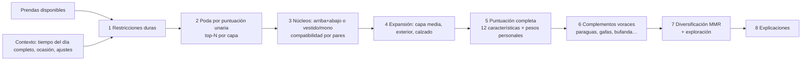

# Motor de recomendaciones

Paquete `packages/stylist-engine` (TypeScript puro, sin I/O, determinista). Lo usan la API
(outfits diarios, cambios de prenda, planificador, viajes, simulación de compras, asistente) y podría
ejecutarse en el móvil para funcionamiento sin conexión.

**No depende de un LLM.** Cada recomendación es el resultado de reglas, restricciones y un modelo de
ranking con pesos aprendidos; cada frase de explicación se deriva de una contribución numérica concreta.
Es reproducible (misma entrada + misma semilla ⇒ misma salida) y medible (tests y benchmark).

## Flujo

1. **Restricciones duras** (`isAllowed`): excluidas/no disponibles, subcategorías vetadas
   («sin zapatos»), ropa de baño, prendas fuera de rango térmico extremo (bermudas con máxima de 9 °C,
   plumífero a 30 °C), formalidad incompatible con la ocasión (±40/55 puntos) y deporte.
2. **Poda**: puntuación unaria por prenda (formalidad, ajuste térmico, estilo de la ocasión y del
   usuario, afinidad aprendida, rotación, colores evitados). Se quedan las N mejores por capa.
3. **Núcleos**: `base|capa media autónoma × parte de abajo` o `vestido/mono`, con compatibilidad por
   pares (color, estilo, formalidad).
4. **Expansión**: capa media (si hace falta), exterior (obligatoria con frío o lluvia, evitada con calor)
   y calzado. Se respetan las prendas forzadas («con mis pantalones negros»).
5. **Puntuación**: `score = Σ wᶠ·fᶠ / Σ wᶠ` sobre 12 características en [0, 1] con compuertas
   (un tiempo o formalidad muy malos hunden el conjunto).
6. **Complementos**: se añaden de uno en uno (uno por hueco) solo si mejoran la puntuación; con
   prioridad meteorológica (paraguas con lluvia ≥ 50 %, gafas con UV ≥ 6, bufanda/guantes con frío).
7. **Diversificación**: *Maximal Marginal Relevance* con similitud de Jaccard entre núcleos (λ = 0,72).
   Con probabilidad 25 % (12 % tras 20 valoraciones) se reserva un hueco de **exploración**: un conjunto
   de estilo menos habitual con ≥ 85 % de la mejor puntuación, marcado «Para explorar».
8. **Explicaciones** a partir de las contribuciones `wᶠ·(fᶠ − 0,5)`.

## Características

| Característica | Qué mide |
|---|---|
| `color` | Armonía por pares ponderada por superficie visible, en CIELAB/LCh con distancia CIEDE2000. Los neutros (negro, blanco, gris, beige, camel, marino, denim, caqui) combinan con todo; los cromáticos se valoran sobre la **rueda RYB del pintor** (mapeo de matiz LCh → RYB) para reconocer complementarios de moda (rojo-verde, azul-naranja). Penaliza > 2 familias cromáticas y premia una base neutra. |
| `pattern` | Un estampado protagonista es bueno; dos estampados intensos compiten. |
| `style` | Coherencia: coseno medio entre vectores de estilo de las prendas principales; penaliza deporte + sastrería. |
| `formality` | Distancia de la formalidad media (ponderada por superficie) a la ventana de la ocasión ± ajustes; penaliza dispersión extrema. |
| `occasionStyle` | Proporción de estilos preferidos/evitados por la ocasión; boda evita blanco/crudo; deporte exige prendas deportivas. |
| `weather` | Modelo térmico + lluvia + calor húmedo (ver abajo). |
| `material` | Estacionalidad de los tejidos, brillo + técnico, doble denim sin contraste. |
| `silhouette` | Equilibrio de volúmenes (oversize + oversize penaliza; contraste premia). |
| `personal` | Estilos explícitos del onboarding + estilos aprendidos, colores favoritos/evitados, ajustes preferidos. |
| `affinity` | Afinidad aprendida por prenda y por pareja de prendas. |
| `rotation` | Penaliza prendas usadas ayer o hace 2–3 días y repetir el mismo conjunto en 14 días. |
| `visual` | Similitud de embeddings (SigLIP) con el centroide de prendas de conjuntos que gustaron (opcional). |

## Modelo térmico (todo el día, no solo la hora actual)

- Aislamiento por prenda (clo) de tablas ISO 9920 / ASHRAE 55 (`packages/shared/src/vocabulary.ts`),
  modulado por el material (lana +35 %, lino −25 %…).
- Aislamiento del conjunto: fórmula de McCullough `Icl = 0,835·Σ + 0,161`.
- Aislamiento requerido en función de la **sensación térmica**: curva por tramos (1,65 clo a 0 °C,
  1,15 a 10 °C, 0,75 a 18 °C, 0,42 a 26 °C) + ajuste personal (±0,12 clo por nivel de friolero/caluroso).
- Para la ventana del usuario (p. ej. 8:00–19:00): el conjunto **con todas las capas** debe cubrir la
  mínima; el conjunto **sin las capas que se pueden quitar** (exterior, capa media sobre base,
  bufanda/gorro) no debe exceder lo requerido a la máxima, mezclando exterior/interior (21 °C) según la
  proporción de tiempo en interiores de la ocasión o el evento.
- Gran oscilación térmica sin capa removible → penalización. Exposición a lluvia
  `prob × (0,35 + 0,65 × exterior)`: protege una prenda exterior impermeable o un paraguas; penaliza
  calzado/prendas sensibles (ante, lona).
- Sin previsión (proveedor caído o fecha > 16 días) se usa la temperatura típica de la estación y se
  avisa al usuario.

## Aprendizaje (el feedback cambia el ranking)

`applyFeedback` (puro, determinista):

- **Pesos de ranking** = coeficientes de una **regresión logística online** sobre las características
  centradas: `P(gusta) = σ(b + Σ wᶠ·4(fᶠ − 0,5))`. Etiquetas: aceptar = 1, ponerse = 1 (peso 1,5),
  guardar = 1 (0,8), rechazar = 0, valoración 1–5 → (r − 1)/4. SGD con regularización L2 hacia los pesos
  por defecto (estabilidad) y suelo 0,05.
- **Afinidad por prenda y por pareja** acotadas en [−1, 1] (máx. 600 parejas).
- **Cambio de prenda** (swap): −afinidad a la retirada, + a la elegida y a sus nuevas parejas.
- **Estilo y color**: se desplazan según el vector de estilo y los colores del conjunto valorado.
- Los conjuntos rechazados no se vuelven a proponer durante 30 días.
- Todo se guarda en `style_profiles` y se muestra al usuario en *Perfil → Tu estilo* (transparencia).
- Cada impresión/acción se registra en `recommendation_events` (con características y semilla) para
  evaluación offline y reentrenamiento.

## Compras: utilidad marginal

- `evaluateCandidate`: genera conjuntos en los contextos habituales del usuario **forzando** el producto
  candidato; cuenta los conjuntos distintos con puntuación ≥ 0,62 → «podrías crear N conjuntos nuevos con
  M prendas que ya tienes».
- `findSimilarOwned`: redundancia con lo que ya tiene (subcategoría, CIEDE2000, estampado, estilo y, si
  hay, embeddings). Los productos casi duplicados (≥ 0,85) sin al menos 2 conjuntos nuevos **no se
  recomiendan**.
- `productScore`: 0,32 compatibilidad con el armario + 0,20 estilo + 0,18 novedad (1 − redundancia) +
  0,12 presupuesto + 0,06 marca favorita + 0,07 talla disponible + 0,05 calidad/frescura del dato.
  **La comisión de afiliación no es una entrada.**
- `wardrobeGaps` («Completa tu armario»): evalúa arquetipos versátiles (camisa blanca, chino beige,
  gabardina, botines marrones…) que el usuario no tiene; solo propone tipos de prenda que el usuario ya
  usa (no se asume nada sobre la persona).

## Calidad y rendimiento

- 24 tests del motor (`pnpm --filter @dressit/stylist-engine test`): solo prendas dadas, conjuntos
  completos, determinismo, cambios por tiempo, día completo con capa removible, formalidad por ocasión,
  prendas forzadas/vetadas, rotación, diversidad, swap, feedback que cambia el ranking, aprendizaje de
  estilo, redundancia de compras, utilidad marginal, huecos del armario, comisión fuera del score.
- CIEDE2000 validado contra los pares de referencia de Sharma, Wu y Dalal (2005).
- Escala: 1 500 prendas → 5 conjuntos en < 2,5 s en el test (poda + beam acotado; típicamente < 100 ms
  con armarios de ~100 prendas).

## Limitaciones conocidas

- Los pesos por defecto y la curva térmica son heurísticos documentados, no ajustados con datos
  reales de usuarios; los eventos registrados permiten calibrarlos (roadmap: evaluación offline con
  NDCG/aceptación y A/B).
- La compatibilidad visual fina (proporciones de una prenda concreta, texturas) depende de los atributos
  disponibles; el embedding visual solo se usa como señal secundaria.
